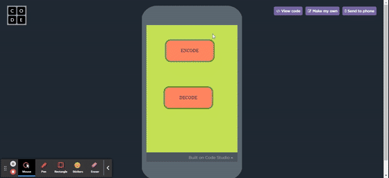

# Enigma Machine

A simulator of the WWII **Enigma I** cipher machine. Type a message, and it's scrambled letter by letter through three rotors and a reflector, using the historical rotor wirings. Because Enigma is symmetric, running the scrambled text back through from the same starting position gives you the original message.

Made by Mouli Grandhi. There are two versions:

| Version | Language | File |
|---|---|---|
| Console version (work in progress) | Python | [`enigma machine.py`](enigma%20machine.py) |
| Phone-style app with screens | JavaScript (Code.org App Lab) | [`app-lab/enigma_machine.js`](app-lab/enigma_machine.js) |

## Demo (App Lab version)



The message *"Hello I am a human I promise"* is encoded into scrambled text, then the app is reset and the scrambled text is put back in, which decodes it to the original message. [Full video with audio (MP4)](media/demo.mp4)

## How it works

1. **Rotors**: each letter passes through three rotors (historical Enigma I rotors I, II, III):
   - Rotor I: `EKMFLGDQVZNTOWYHXUSPAIBRCJ`
   - Rotor II: `AJDKSIRUXBLHWTMCQGZNPYFVOE`
   - Rotor III: `BDFHJLCPRTXVZNYEIWGAKMUSQO`
2. **Reflector**: the signal bounces off a reflector and goes back through the rotors in reverse. The App Lab version uses Reflector B (`YRUHQSLDPXNGOKMIEBFZCWVJAT`); the Python version uses Reflector A (`EJMZALYXVBWFCRQUONTSPIKHGD`).
3. **Stepping**: the right rotor turns one position before every letter, and turnover notches advance the next rotor. This is why the same letter typed twice comes out different.
4. **Plugboard** (Python version, in progress): reads up to 10 letter-pair swaps from the user.

## Running it

**Python version**

This version is a work in progress. It has the rotor, stepping, reflector, and plugboard-input functions, but no main program yet to read a message and print the result.

**App Lab version**

The code uses Code.org App Lab functions (`onEvent`, `setScreen`, `getText`, `setProperty`), so it runs inside [App Lab](https://studio.code.org/projects/applab). It expects these screens and elements:

| Screen | Elements |
|---|---|
| Start screen | `encode` and `decode` buttons |
| `codingscreen` | `encodetext` text box, `goencode` button |
| `outputscrn` | `outputbox` text area |

A printout of the original code is in [`app-lab/Enigma_Machine_Code.pdf`](app-lab/Enigma_Machine_Code.pdf).

## Repo layout

```
enigma machine.py                  # Python version
app-lab/enigma_machine.js          # App Lab (JavaScript) version
app-lab/Enigma_Machine_Code.pdf    # Original code printout
media/demo.gif, media/demo.mp4     # Demo video
```
